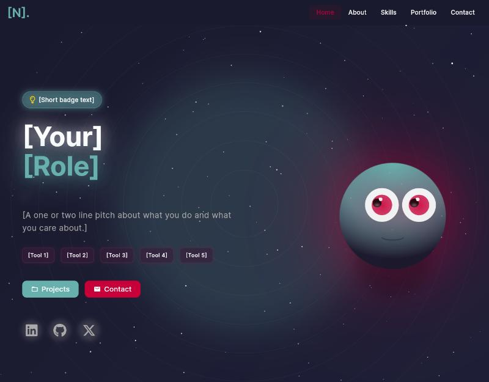
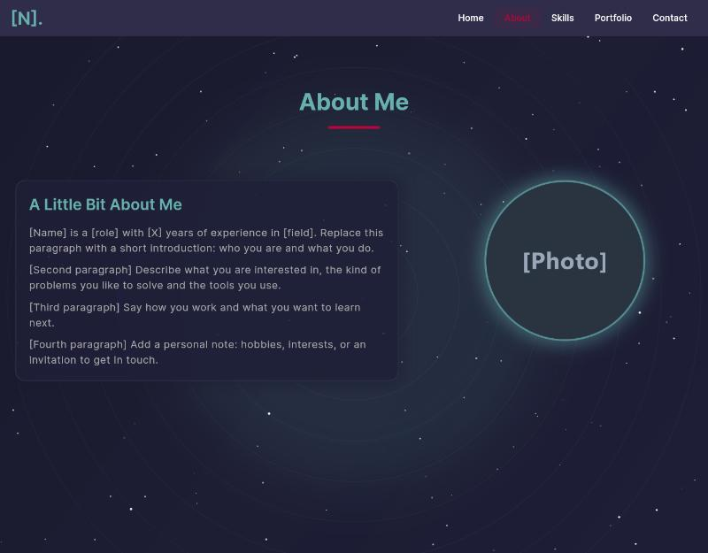
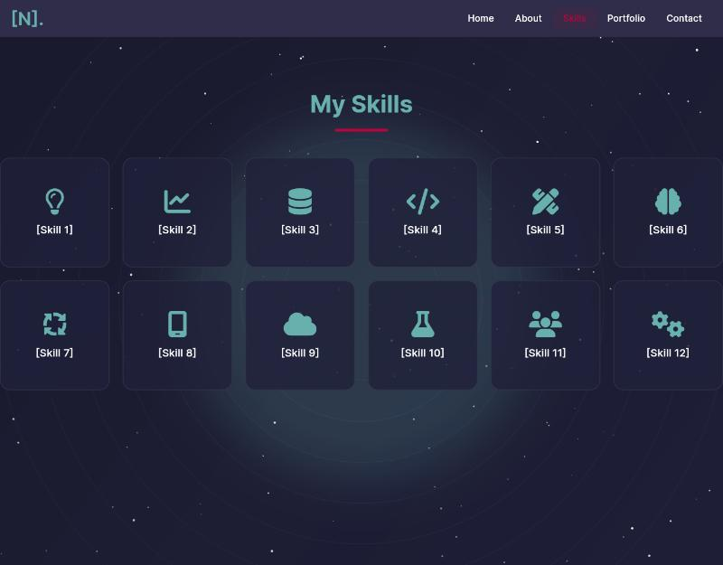
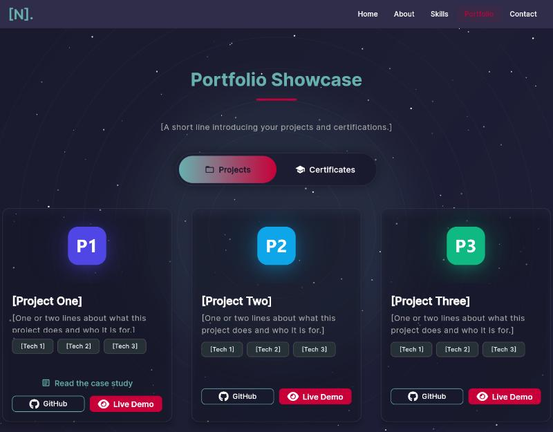
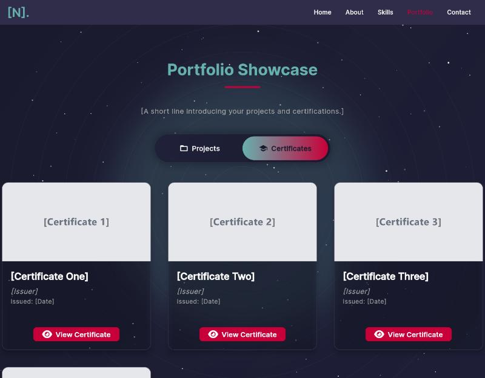
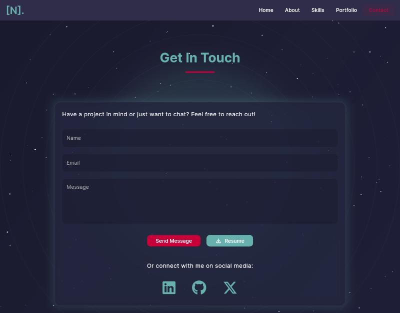

<div align="center">

# Flutter Portfolio Template

**A clean, animated personal portfolio website you can make your own in minutes. Replace the placeholders, add your pictures, publish for free.**

[**Live demo**](https://himanshu-moderator.github.io/flutter-portfolio-template/) · [Screens](#screens) · [Features](#features) · [Quick start](#quick-start) · [Customise it](#customise-it) · [Publish it](#publish-it-for-free)


</div>

<p align="center">
  
  
  
</p>

<p align="center">
  
  
  
</p>

> **Try it first.** Open the [live demo](https://himanshu-moderator.github.io/flutter-portfolio-template/). Everything you see is placeholder content in `[square brackets]`. Make it yours by editing **one file** and swapping a few pictures.

## What it is

A ready-made portfolio site for students, developers, designers and product people who want a polished personal page without building one from scratch. It is a full Flutter web app with a starry animated background, smooth section transitions and a layout that adapts to phone, tablet and desktop.

You do **not** need to know Flutter to use it. All your text, links, projects and skills live in a single, clearly labelled file.

## Screens

| Section | What you get |
| --- | --- |
| **Splash** | An opening animation with your site title |
| **Home** | Badge, big title, rotating role text, short pitch, tool chips and social icons |
| **About** | Your photo and a few paragraphs about you |
| **Skills** | A grid of skill tiles with icons |
| **Portfolio** | Project cards with logo, tags, GitHub and live links (and an optional case-study PDF), plus a certificates gallery |
| **Contact** | A message form, a Resume button that opens your PDF full screen with a Download button, and your social links |

## Features

- **One file to edit**: every piece of text, every link and every project is in `lib/personal_data/portfolio_content.dart`.
- **Responsive**: looks right on phones, tablets and desktops.
- **Animated but light**: starry background, typing role text, glowing cards and smooth section changes.
- **Built-in resume viewer**: opens your PDF full screen on the page, with a Download button.
- **Projects and certificates**: add or remove cards by copying one block.
- **Beginner friendly**: clear folders, comments in the code, and a step-by-step guide in [`docs/CUSTOMIZE.md`](docs/CUSTOMIZE.md).
- **Free hosting**: publishes to GitHub Pages in a couple of minutes.

## Quick start

1. **Install Flutter** (web is enough): https://docs.flutter.dev/get-started/install
2. **Get the code**: click **Use this template** (or **Fork**) on GitHub, then clone your copy.
3. **Install packages**:

   ```bash
   flutter pub get
   ```

4. **Run it**:

   ```bash
   flutter run -d chrome
   ```

5. **Make it yours**: open `lib/personal_data/portfolio_content.dart` and replace every `[placeholder]`.

## Customise it

| I want to change... | Open |
| --- | --- |
| My name, role, bio, projects, skills, links | `lib/personal_data/portfolio_content.dart` |
| My photo | `assets/profile.png` |
| Project logos | `assets/projects/` |
| Certificate pictures | `assets/certificates/` |
| My resume | `assets/resume/Resume.pdf` |
| Colours and fonts | `lib/utils/constants.dart` |
| Browser tab title and icon | `web/index.html`, `web/favicon.png` |

The full walk-through, with picture sizes and troubleshooting, is in [`docs/CUSTOMIZE.md`](docs/CUSTOMIZE.md).

## Project structure

```
lib/
  personal_data/   all your content (the one file you edit)
  hero/            the animated home section
  screens/         About, Skills, Portfolio, Contact, Splash, Home page
  widgets/         shared pieces: navbar, resume viewer, animations, footer
  utils/           colours, fonts, spacing
  main.dart        app entry point
assets/            your photo, project logos, certificates, resume
web/               page title, favicon, app icons
docs/              customisation guide and screenshots
```

## Publish it for free

Build the site, telling Flutter the path it will live at (use your repository name):

```bash
flutter build web --release --base-href /YOUR-REPO-NAME/
```

Copy the contents of `build/web` to a branch called `gh-pages`, add an empty file named `.nojekyll`, copy `index.html` to `404.html`, then in **Settings > Pages** choose the `gh-pages` branch. Your site appears at `https://YOUR-USERNAME.github.io/YOUR-REPO-NAME/`.

For a main site at `https://YOUR-USERNAME.github.io/`, name the repository `YOUR-USERNAME.github.io` and build with `--base-href /`.

## Tech stack

| | |
| --- | --- |
| Framework | Flutter (web), Dart |
| UI | Custom animated widgets, `rive` animations |
| Fonts and icons | `google_fonts`, `font_awesome_flutter` |
| Links | `url_launcher` |
| Hosting | GitHub Pages (any static host works) |

## The footer credit

The small line at the bottom, "Built with Flutter by Himanshu Chatterjee", is the template credit. It lives in `lib/widgets/footer_section.dart` and must stay in place as a condition of the [licence](LICENSE). A GitHub Action in this repository fails if that file is changed, so please leave it as it is. Everything else is yours to change.

## Licence

MIT with one extra condition: keep the credit footer. See [LICENSE](LICENSE).

## About

Built by [Himanshu](https://github.com/Himanshu-moderator). If this template helped you, a star on the repository is much appreciated.
